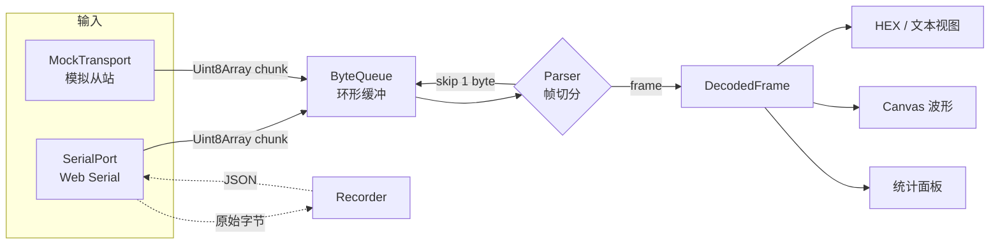

<div align="center">

# PortScope

**浏览器里的串口协议分析仪** —— Web Serial 直连、CRC 驱动帧同步、实时波形、会话录制回放。

零后端、零安装、零依赖运行时，构建产物 25 KB。

[](https://github.com/wenjialei15/portscope/actions/workflows/deploy.yml)
[](./LICENSE)

</div>

---

## 这是什么

调试串口时通常要装一堆上位机：串口助手看 HEX，示波器看波形，Modbus Poll 解协议，再开个 Excel 记数据。PortScope 把这几件事塞进一个网页里：插上 USB 转串口，点一下连接，实时看到帧结构、解析出的寄存器和滚动波形，全过程不需要装任何软件。

因为它本身是一个静态页面，所以也可以直接挂在 GitHub Pages 上发给别人看——**这就带来一个必须解决的问题：对方手里没有开发板**。所以项目内置了一个在浏览器里跑的 Modbus 从站，任何人点开就能看到完整效果。

## 在线试用

> **<https://wenjialei15.github.io/portscope/>**

点击顶部「模拟设备」，会自动启动一个模拟从站并开始循环读取——不需要任何硬件。
也可以直接在地址后面加 `?demo=1`，打开页面就自动开始，适合贴给别人看。
如果手边有开发板，装个 USB 转串口驱动，点「连接串口」即可。

> Web Serial 是 Chromium 系专有 API（Chrome / Edge 89+），页面必须是 HTTPS 或 localhost。Firefox 与 Safari 不支持，但「模拟设备」模式在它们下面也能正常跑。

## 功能

**数据视图**
- HEX / 文本 / 解码三种视图，随时切换且不丢历史
- RX 蓝色、TX 橙色，CRC 错误整行标红
- 自动滚动、暂停、清空

**协议解析**
- Modbus RTU：功能码 `01 02 03 04 05 06 0F 10`，含异常响应解码
- 文本行模式：按 LF 切分，自动从 `key=value` 里提取数值画曲线
- 原始流模式：不做任何协议假设，按空闲间隔切帧
- 解析器是插件式的，加自己的协议不用碰主流程（见下文）

**可视化**
- Canvas 实时波形，时间窗口随数据自动扩展至 30 秒
- **每个通道独立纵向缩放**——温度和电压的量级差一个数量级，共用 Y 轴会让小信号被压成直线
- 图例显示各通道当前原始值，最多 6 个通道
- 寄存器值直接变成曲线，不用另开上位机

**发送**
- HEX / 文本输入，支持 Enter 快捷发送
- 可配置周期循环发送
- 内置快捷指令：读寄存器、写寄存器、故意构造非法地址看异常响应

**录制与回放**
- 录制的是**原始字节 + 相对时间戳**，不是解析结果——同一份录制换个解析器还能重新分析
- 回放会真实复现分片时序，长空闲自动压缩
- 会话可导出 CSV

**其他**
- 深色 / 浅色主题，跟随你的选择而非系统
- 响应式布局，窄屏自动堆叠

## 快速开始

```bash
git clone https://github.com/<your-name>/portscope.git
cd portscope
npm install
npm run dev        # http://localhost:5173
```

| 命令 | 作用 |
| --- | --- |
| `npm run dev` | 开发服务器 |
| `npm run build` | 类型检查 + 生产构建 |
| `npm test` | 单元测试（Vitest） |
| `npm run typecheck` | 只做类型检查 |

## 架构



核心是一条单向管线：**字节流 → 环形缓冲 → 解析器切帧 → 解码结果 → 三个消费者**。界面不参与任何协议判断，解析器也不知道 DOM 的存在，所以解析器可以脱离浏览器单独测试——`tests/` 里 33 个用例全部只依赖 Node。

```
src/
  core/
    byte-queue.ts    环形缓冲，容量上限 + 丢弃最旧数据
    crc.ts           CRC-16/MODBUS 查表实现
    parsers/
      modbus.ts      CRC 定界 + 请求/响应/异常解码
      raw.ts         空闲超时 / 文本行解析器
      index.ts       解析器注册表
    transport.ts     传输抽象：真实串口 + 模拟从站
    recorder.ts      录制、回放、格式校验
    stats.ts         滑动窗口速率统计
  ui/
    chart.ts         手写 Canvas 波形
  main.ts            状态与事件绑定
tests/               Vitest 单元测试
```

## 几个设计取舍

**为什么不用 React / Vue。**
这是一个单屏工具，状态全部集中在 `main.ts` 的一个对象里，没有组件复用需求，也没有路由。引框架会让 bundle 从 25 KB 涨到 150 KB 以上，而项目真正的复杂度在协议解析，不在视图层。用一个 30 行的 `el()` 助手加直接 DOM 操作就够了。

**为什么手写 Canvas 而不是 Chart.js。**
串口数据是高频推送的，通用图表库每次更新都要重建数据集对象，在 1000 帧/秒的场景下开销不可接受。手写的绘制逻辑不到 150 行，滚动窗口、坐标变换、降采样都完全可控。

**为什么用 CRC 做帧同步。**
Modbus RTU 既没有帧头也没有长度字段，帧长由功能码决定；更麻烦的是同一功能码的请求和响应长度不同，所以连"根据方向猜长度"都做不到。可行的办法是枚举所有可能的帧长，用 CRC 逐个试探——CRC 本身就是最强的帧边界特征。代价是每帧可能要多算几次 CRC，实测 115200 波特率下完全无感。
全部候选都失败时不丢整帧，而是丢 1 个字节重同步，这样噪声前缀不会连带吃掉后面的正常帧。

**为什么内置模拟设备。**
开源项目最常见的问题是"别人打不开"：没有硬件就没有数据，没有数据界面就是一片空白，访客三秒内关掉页面。模拟器让这个项目在**任何人的浏览器里**都是可用的、可演示的。它同时充当集成测试——响应会被刻意拆成两个 chunk 发出，用来验证解析器对分片的容忍度。

**为什么录制存原始字节而不是解析结果。**
解析逻辑会演进。存原始字节意味着昨天录的数据今天换了解析器还能重新分析，也不会因为解码字段调整就让历史录制失效。

## 添加自己的协议解析器

实现 `Parser` 接口，注册到数组即可，主流程和界面会自动出现这个选项。

```ts
// src/core/parsers/my-proto.ts
import type { Parser } from '../types';

export const myProtoParser: Parser = {
  id: 'my-proto',
  name: 'MyProto',
  hint: '帧头 AA 55 + 长度 + 负载 + 校验和',
  parse(queue) {
    if (queue.size < 4) return null;                       // 数据不足，继续等

    if (queue.at(0) !== 0xaa || queue.at(1) !== 0x55) {
      return { kind: 'skip', count: 1 };                   // 不是帧首，丢 1 字节重同步
    }

    const len = queue.at(2);
    const total = len + 5;                                 // 头 3 + 负载 + 校验 2
    if (queue.size < total) return null;

    const frame = queue.slice(0, total);                   // 必须拷贝
    return {
      kind: 'frame',
      frame,
      consumed: total,
      decoded: {
        protocol: 'MyProto',
        title: `${len} 字节负载`,
        fields: [{ k: '长度', v: String(len) }],
        series: [{ label: 'value', value: frame[3] }],     // 有 series 就会画进波形
      },
    };
  },
};
```

```ts
// src/core/parsers/index.ts
export const PARSERS: Parser[] = [modbusParser, lineParser, rawParser, myProtoParser];
```

三个返回值分别对应三种状态：切出帧、跳过若干字节、数据不足。只要这三件事想清楚了，任何自定界协议都能接进来。

## 已知限制

- 只支持 Chromium 系浏览器（Web Serial 尚未进入标准，Firefox 已明确反对）
- 仅实现 Modbus **RTU**，TCP 尚未支持
- 寄存器按 16 位无符号大端展示，`float32` / 32 位组合值还不支持
- 波形通道上限 6 个，数据不落盘，刷新页面即清空
- 一次只能连接一个串口

## 路线图

- [ ] Modbus RTU 帧构造器（图形化选功能码，自动算 CRC）
- [ ] 32 位 / 浮点寄存器视图
- [ ] Modbus TCP（走 WebSocket 桥接）
- [ ] 自定义解析器的可视化配置（无需写代码）
- [ ] 会话导出为 PNG 波形图，便于贴进报告

## 许可

[MIT](./LICENSE)
